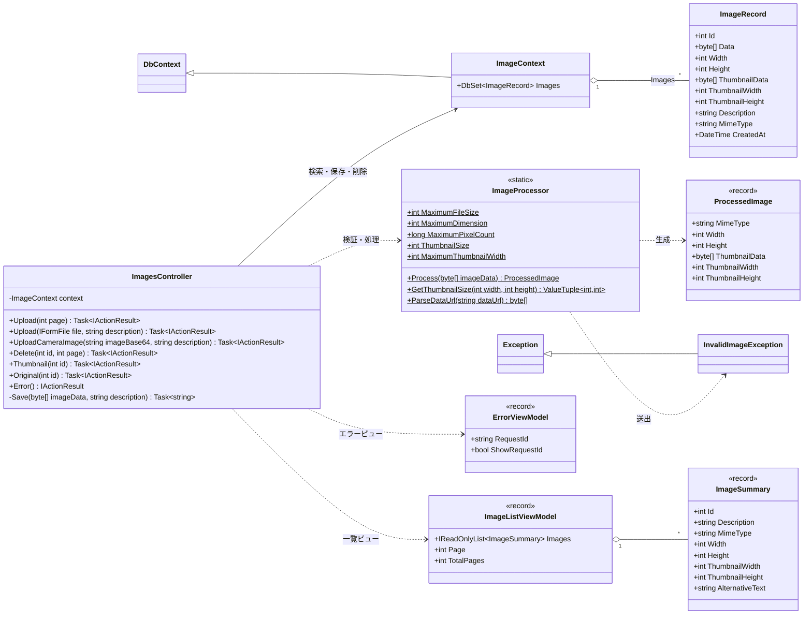
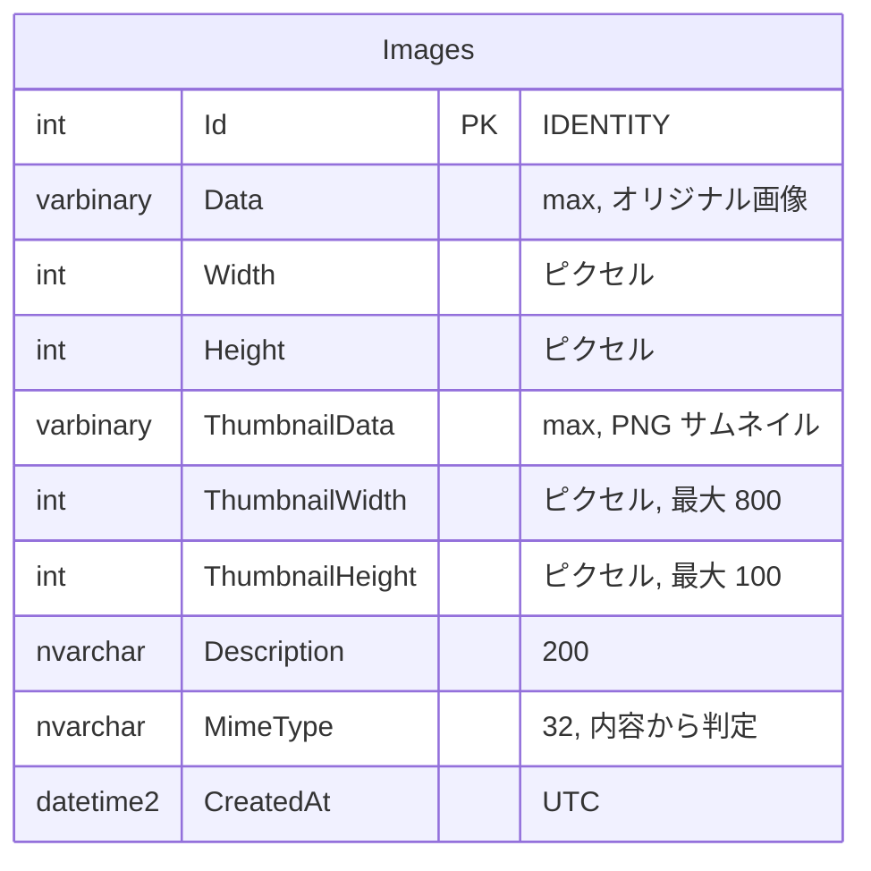
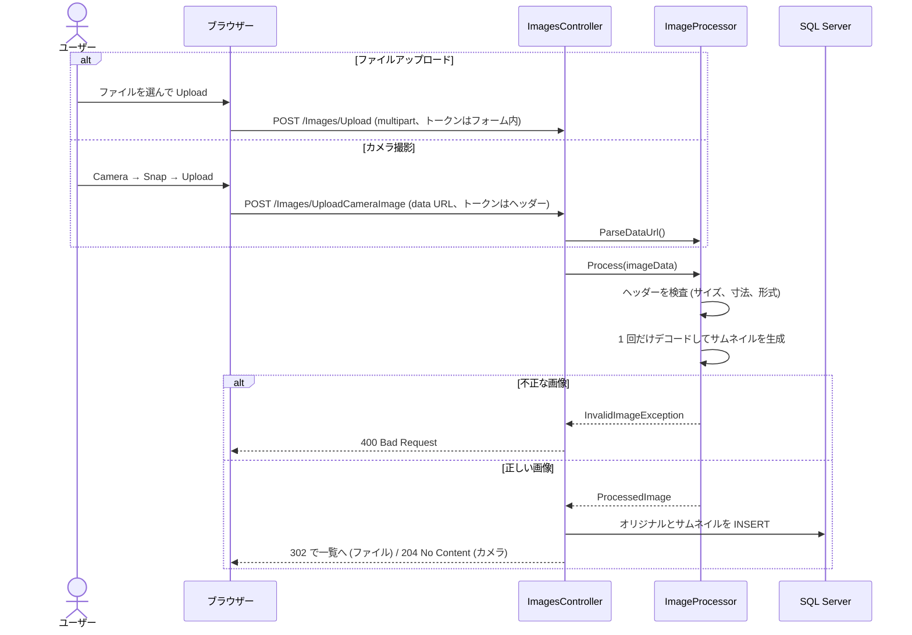

# Shos.ImageUploadSample

[English](README.md) | [日本語](README.jp.md)

ASP.NET Core 10.0 MVC で作った画像アップロードのサンプルアプリケーションです。ファイル選択またはブラウザーのカメラ撮影で画像をアップロードし、自動生成したサムネイルとともに、Entity Framework Core 10 経由で SQL Server に保存します。

短時間で読み切れる規模ですが、実際の画像アップロードに必要な要素をひととおり押さえています。信頼できない画像の安全な検証、軽い一覧ページ、フォームとカメラ用の `fetch` リクエストの両方での CSRF 対策、どの OS でも動くテストです。

## 本リポジトリのポイント

| テーマ | このサンプルでの実装 |
|---|---|
| **安全な画像の検証** | まず画像のヘッダーだけを読み、2 MB、幅・高さいずれかが 8000px、または総画素数が 16 メガピクセルを超えるものはデコード前に拒否します（解凍爆弾対策）。MIME 型はクライアントの申告ではなく、ファイルの内容から判定します。 |
| **効率的な画像処理** | アップロードごとのデコードは 1 回だけで、アスペクト比を維持した最大 800×100px の PNG サムネイルを SkiaSharp で作ります。 |
| **軽い一覧ページ** | 一覧のクエリは画像データを含まない `ImageSummary` に射影します。ページを開いた時点ではサムネイルだけを読み込み、オリジナル画像はサムネイルをクリックしたときに取得してモーダルで表示します。 |
| **効率的な削除** | 確認ダイアログのあと、`ExecuteDeleteAsync` で画像データを読み込まずに行（サムネイルとオリジナル）を削除します。 |
| **CSRF 対策** | 偽造防止トークンの検証を全体に適用しています。カメラ画像のアップロードでは、`fetch` がトークンをリクエストヘッダーで送ります。 |
| **レスポンシブ UI** | Bootstrap 5 のカードと、画面幅に応じて 2〜6 列になるグリッドを使っています。スマホではモーダルが全画面になります。 |
| **OS を問わないテスト** | 結合テストでは SQL Server をインメモリの SQLite に置き換えるので、`dotnet test` は Windows、Linux、macOS で動きます（GitHub Actions でも Ubuntu で実行）。 |
| **新しい C#** | C# 14 の拡張メンバー（`extension(SKCodec codec) { ... }`）、プライマリコンストラクター、レコード、コレクション式、正規表現のソース生成を使っています。 |

## 主な機能

- **ファイルアップロード**: 画像ファイルを選び、説明文（任意）を付けてアップロード
- **カメラ撮影**: ブラウザーのカメラ（WebRTC）で撮影してアップロード
- **サムネイル生成**: 画像ごとにサムネイルを自動生成
- **画像一覧**: 新しい順、1 ページ 24 件。サムネイルをクリックするとオリジナル画像を表示
- **削除**: 確認のうえ、画像（サムネイルとオリジナル）を削除

## 技術スタック

- **フレームワーク**: ASP.NET Core 10.0 MVC、C# 14
- **データベース**: SQL Server（既定は LocalDB）
- **ORM**: Entity Framework Core 10.0
- **画像処理**: [SkiaSharp](https://github.com/mono/SkiaSharp)（MIT ライセンス、クロスプラットフォーム）
- **テスト**: xUnit、Microsoft.AspNetCore.Mvc.Testing、SQLite（インメモリ）
- **フロントエンド**: HTML5、JavaScript、jQuery、Bootstrap 5

## アーキテクチャ

### クラス図



### ER 図

オリジナル画像（`Data` 列）とサムネイル（`ThumbnailData` 列）は、`Images` テーブルの 1 つの行に別々の列として保存されます。そのため、行を削除すると両方が消えます。



### アップロードの流れ



どちらのアップロード方法も、画像を受け取ったあとは同じ画像処理・保存処理を通ります。ファイルフォームは `multipart/form-data` で送信し、カメラ画像は `fetch` でキャンバス画像と説明文を URL エンコード形式で送信して、偽造防止トークンをリクエストヘッダーに設定します。コントローラーは画像データを `ImageProcessor` に渡し、オリジナル画像と生成したサムネイルを 1 つの `ImageRecord` にまとめて保存します。保存成功時、ファイルアップロードは一覧へリダイレクトし、カメラアップロードは `204` を返してからブラウザーが一覧を再読み込みします。

### エンドポイント

| メソッド | パス | 内容 |
|---|---|---|
| GET | `/` または `/Images/Upload?page=n` | アップロードフォームと画像一覧（1 ページ 24 件） |
| POST | `/Images/Upload` | ファイルのアップロード（multipart フォーム）。一覧へリダイレクト |
| POST | `/Images/UploadCameraImage` | カメラ画像のアップロード（`data:image/...;base64,`）。204 を返す |
| POST | `/Images/Delete/{id}?page=n` | 画像の削除。一覧へリダイレクト |
| GET | `/Images/Thumbnail/{id}` | サムネイル（PNG） |
| GET | `/Images/Original/{id}` | オリジナル画像 |

## 必要な環境

- [.NET 10.0 SDK](https://dotnet.microsoft.com/download/dotnet/10.0)
- SQL Server LocalDB（Visual Studio に付属、Windows のみ）
  - Linux や macOS では SQL Server（Docker コンテナなど）を用意し、接続文字列を変更してください
- カメラ機能には WebRTC 対応ブラウザーが必要です

## はじめかた

### 1. リポジトリのクローン

```bash
git clone https://github.com/Fujiwo/Shos.ImageUploadSample.git
cd Shos.ImageUploadSample
```

### 2. ビルド

```bash
dotnet build
```

### 3. データベースのセットアップ

Entity Framework Core のマイグレーションでデータベースを作成します。

```bash
# EF Core ツールのインストール (初回のみ)
dotnet tool install --global dotnet-ef

cd ImageUploadSample
dotnet ef database update
```

接続文字列は `appsettings.json` の `ConnectionStrings:ImageContext` です。接続先やデータベース名はここで変更できます（既定のデータベース名は `ImageUploadSample-ecb85b14-...` のように GUID 付きです）。

```json
"ConnectionStrings": {
  "ImageContext": "Server=(localdb)\\mssqllocaldb;Database=ImageUploadSample-ecb85b14-ebd2-4744-bec9-be8f021688b7;Trusted_Connection=True;MultipleActiveResultSets=true"
}
```

`dotnet ef` も `Program.cs` を通じて同じ設定を読むので、`dotnet ef database update` はアプリと同じデータベースに対して実行されます。

エンティティ（`Models/ImageContext.cs` の `ImageRecord`）を変更した場合は、マイグレーションを追加してから適用します。

```bash
dotnet ef migrations add <マイグレーション名>
dotnet ef database update
```

### 4. 起動

```bash
cd ImageUploadSample
dotnet run
```

コンソールに表示される URL をブラウザーで開いてください（`launchSettings.json` の設定では `https://localhost:7020` または `http://localhost:5257`）。

## 使い方

### 画像ファイルをアップロードする

1. ホームページを開く
2. **Choose Image** で画像ファイルを選ぶ
3. 説明文を入力する（任意）
4. **Upload** をクリックする

### カメラで撮影してアップロードする

1. **Camera** をクリックし、カメラへのアクセスを許可する
2. **Snap** で撮影する
3. 説明文を入力する（任意）
4. **Upload** をクリックする

### 画像の表示と削除

- アップロードした画像は、新しい順にサムネイルで一覧表示されます（1 ページ 24 件）
- サムネイルをクリックすると、オリジナル画像がモーダルで表示されます
- サムネイルの下の **Delete** をクリックし、確認すると画像（サムネイルとオリジナル）が削除されます

## プロジェクト構成

```
Shos.ImageUploadSample.sln
ImageUploadSample/
├── Controllers/
│   └── ImagesController.cs     # 一覧、アップロード、削除、画像配信、エラーページ
├── Models/
│   ├── ImageContext.cs         # エンティティ ImageRecord と DbContext
│   ├── ImageListViewModel.cs   # 一覧用のビューモデル (ImageSummary, ImageListViewModel)
│   └── ErrorViewModel.cs       # エラーページ用のビューモデル
├── Services/
│   └── ImageProcessor.cs       # 検証、形式判定、サムネイル生成、data URL の解析
├── Views/
│   ├── Images/
│   │   ├── Upload.cshtml       # アップロードフォーム、画像一覧、モーダル、カメラのスクリプト
│   │   └── Upload.cshtml.css   # 一覧用のスコープ付き CSS
│   └── Shared/
│       ├── _Layout.cshtml      # 共通レイアウト
│       └── _Layout.cshtml.css  # レイアウト用のスコープ付き CSS
├── Migrations/                 # EF Core マイグレーション
├── appsettings.json            # 設定 (接続文字列)
└── Program.cs                  # エントリポイント
ImageUploadSample.Tests/        # 単体テストと結合テスト (xUnit)
.github/
├── workflows/build.yml         # CI: 復元、ビルド、テスト、脆弱なパッケージの検査
└── copilot-instructions.md     # GitHub Copilot 向けの指示 (CLAUDE.md と同内容)
CLAUDE.md                       # Claude Code 向けの指示
Reviews/                        # コードレビューの記録
docs/                           # 設計メモ
```

Razor の CSS 分離ファイル (`*.cshtml.css`) は、ビルド時に `ImageUploadSample.styles.css` にまとめられます。このバンドルは共通レイアウトから読み込むため、個別にリンクする必要はありません。

## テスト

```bash
dotnet test
```

結合テストは `WebApplicationFactory` を使い、SQL Server をインメモリの SQLite に置き換えるので、どの OS でも動きます。GitHub Actions（`.github/workflows/build.yml`）では、Ubuntu 上でビルド、テスト、脆弱なパッケージの検査を実行しています。脆弱な NuGet パッケージ（推移的な依存関係を含む）が報告されると、ジョブは失敗します。

## 制限事項

- 最大ファイルサイズ: 2 MB（ファイル、カメラとも）
- 最大画像サイズ: 幅・高さとも 8000px
- 最大総画素数: 16 メガピクセル
- サムネイルの最大サイズ: 800×100px
- 対応形式: PNG、JPEG、GIF、BMP、WebP（内容から判定）
- 説明文: 最大 200 文字
- カメラ機能: HTTPS（または localhost）と WebRTC 対応ブラウザーが必要
- **認証・認可はありません。** 誰でも画像をアップロード・削除でき、アップロードされた画像はすべて誰にでも公開されます。学習・デモ用のサンプルとして使い、そのまま本番環境で運用しないでください。

## ライセンス

このプロジェクトは MIT ライセンスで公開しています。詳細は [LICENSE.txt](LICENSE.txt) を参照してください。

## 作者

小島 富治雄 (Fujio Kojima): 日本のソフトウェア開発者

- Microsoft MVP for Development Tools - Visual C# (2005 年 7 月 - 2014 年 12 月)
- Microsoft MVP for .NET (2015 年 1 月 - 2015 年 10 月)
- Microsoft MVP for Visual Studio and Development Technologies (2015 年 11 月 - 2018 年 6 月)
- Microsoft MVP for Developer Technologies (2018 年 11 月 - 2026 年 6 月)

## 参考資料

- [ASP.NET Core のドキュメント](https://learn.microsoft.com/ja-jp/aspnet/core/)
- [Entity Framework Core のドキュメント](https://learn.microsoft.com/ja-jp/ef/core/)
- [SkiaSharp](https://github.com/mono/SkiaSharp)
