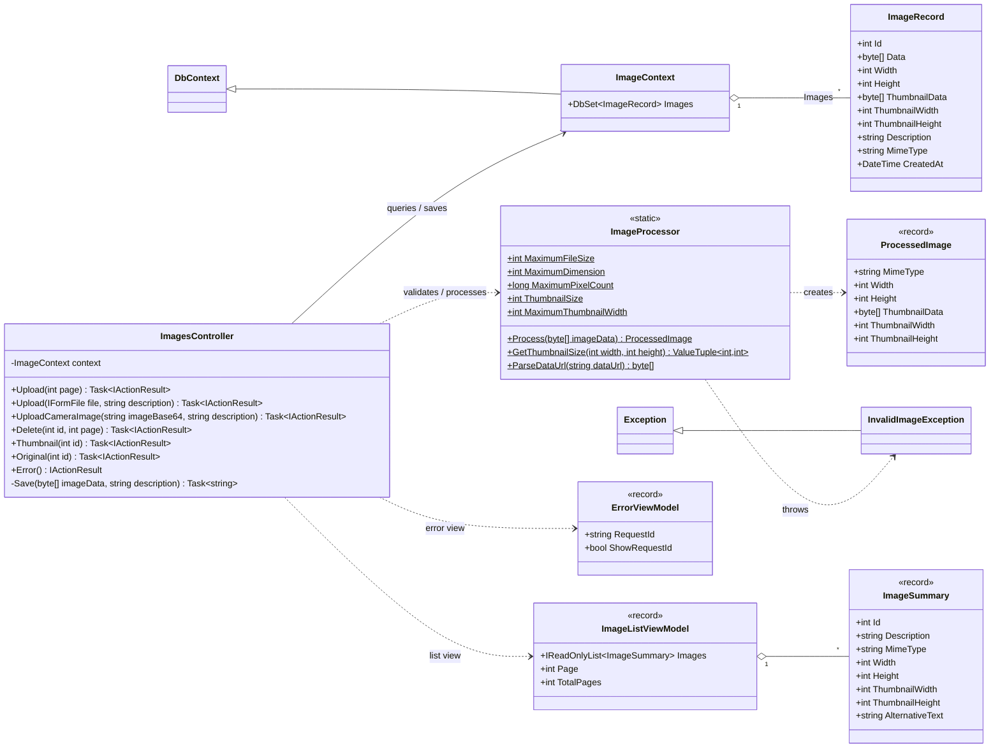
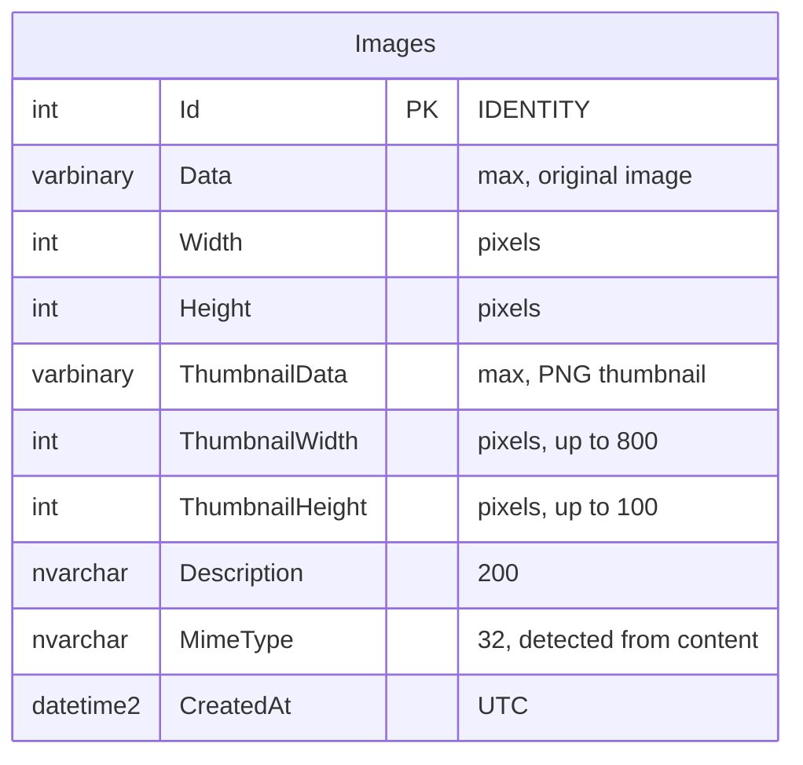
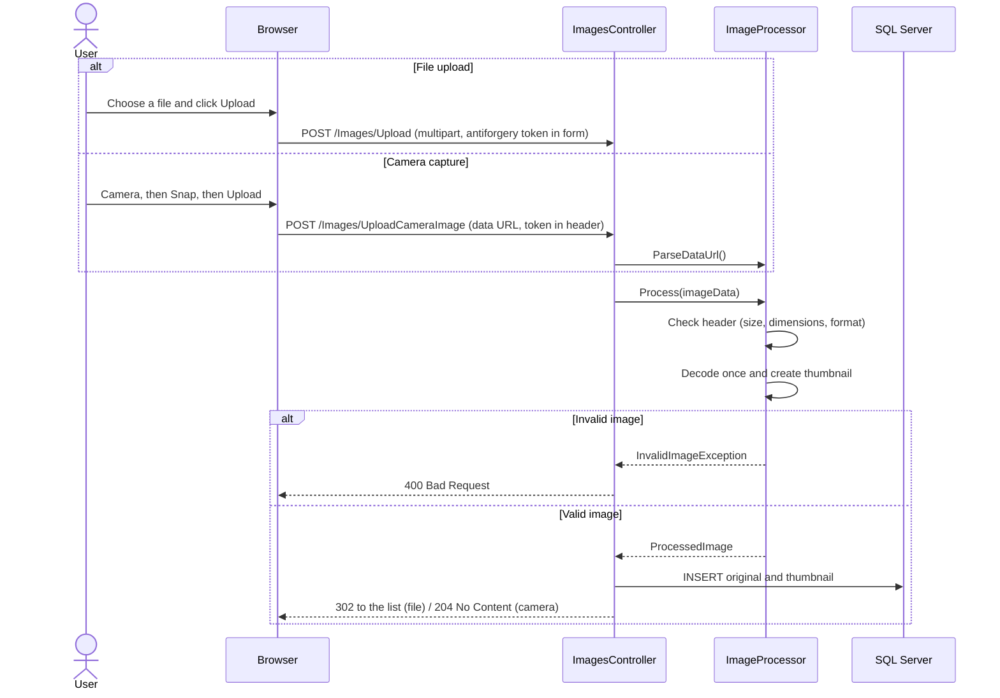

# Shos.ImageUploadSample

[English](README.md) | [日本語](README.jp.md)

A sample ASP.NET Core 10.0 MVC application that uploads images, from a file or from the browser camera, and stores them, along with generated thumbnails, in SQL Server through Entity Framework Core 10.

It is small enough to read in one sitting, yet covers the things a real image upload needs: validating untrusted images safely, keeping the list page light, CSRF protection for both forms and the camera's `fetch` request, and tests that run on any OS.

## Highlights

| Topic | What this sample does |
|---|---|
| **Safe image validation** | Reads only the image header first and rejects files over 2 MB, over 8000 px in either dimension, or over 16 megapixels before decoding them (protection against decompression bombs). The MIME type is detected from the content, not taken from the client. |
| **Efficient processing** | Each upload is decoded only once, to create an aspect-ratio-preserving PNG thumbnail bounded to 800 × 100 px with SkiaSharp. |
| **Light list page** | The list query projects to `ImageSummary` without the image blobs. The page loads only thumbnails; an original is fetched when its thumbnail is clicked and shown in a modal. |
| **Efficient delete** | `ExecuteDeleteAsync` deletes the row (thumbnail and original together) without loading the blobs, after a confirmation dialog. |
| **CSRF protection** | Antiforgery validation is applied globally. The camera upload sends the token in a request header from `fetch`. |
| **Responsive UI** | Bootstrap 5 cards and a grid of 2 to 6 columns depending on the screen width. The modal goes full screen on phones. |
| **Cross-platform tests** | Integration tests replace SQL Server with in-memory SQLite, so `dotnet test` runs on Windows, Linux and macOS (and in GitHub Actions on Ubuntu). |
| **Modern C#** | C# 14 extension members (`extension(SKCodec codec) { ... }`), primary constructors, records, collection expressions and generated regular expressions. |

## Features

- **File upload**: choose an image file and upload it with an optional description
- **Camera capture**: take a picture with the browser camera (WebRTC) and upload it
- **Thumbnails**: a thumbnail is generated automatically for each image
- **Image list**: newest first, 24 images per page; click a thumbnail to view the original
- **Delete**: delete an image (thumbnail and original) after confirmation

## Tech stack

- **Framework**: ASP.NET Core 10.0 MVC, C# 14
- **Database**: SQL Server (LocalDB by default)
- **ORM**: Entity Framework Core 10.0
- **Image processing**: [SkiaSharp](https://github.com/mono/SkiaSharp) (MIT license, cross-platform)
- **Tests**: xUnit, Microsoft.AspNetCore.Mvc.Testing, SQLite (in memory)
- **Front end**: HTML5, JavaScript, jQuery, Bootstrap 5

## Architecture

### Class diagram



### ER diagram

The original image (the `Data` column) and its thumbnail (the `ThumbnailData` column) are stored as separate columns in a single row of the `Images` table, so deleting the row removes both.



### Upload flow



Both upload endpoints use the same image processing and save path after receiving the image. The file form sends `multipart/form-data`; the camera code sends the canvas image and description as URL-encoded form data with `fetch`, and puts the antiforgery token in a request header. The controller passes the image bytes to `ImageProcessor`, then stores the original and generated thumbnail together in one `ImageRecord`. After a successful save, the file upload redirects to the list; the camera endpoint returns `204`, and the browser reloads the list.

### Endpoints

| Method | Path | Description |
|---|---|---|
| GET | `/` or `/Images/Upload?page=n` | Upload forms and the image list (24 per page) |
| POST | `/Images/Upload` | Upload a file (multipart form); redirects to the list |
| POST | `/Images/UploadCameraImage` | Upload a camera image (`data:image/...;base64,`); returns 204 |
| POST | `/Images/Delete/{id}?page=n` | Delete an image; redirects to the list |
| GET | `/Images/Thumbnail/{id}` | Thumbnail (PNG) |
| GET | `/Images/Original/{id}` | Original image |

## Requirements

- [.NET 10.0 SDK](https://dotnet.microsoft.com/download/dotnet/10.0)
- SQL Server LocalDB (included with Visual Studio, Windows only)
  - On Linux or macOS, use SQL Server (for example, in a Docker container) and change the connection string
- A browser with WebRTC support for the camera feature

## Getting started

### 1. Clone the repository

```bash
git clone https://github.com/Fujiwo/Shos.ImageUploadSample.git
cd Shos.ImageUploadSample
```

### 2. Build

```bash
dotnet build
```

### 3. Set up the database

Create the database with Entity Framework Core migrations:

```bash
# Install the EF Core tools (first time only)
dotnet tool install --global dotnet-ef

cd ImageUploadSample
dotnet ef database update
```

The connection string is `ConnectionStrings:ImageContext` in `appsettings.json`. Change the server or database name there (the default database name includes a GUID, such as `ImageUploadSample-ecb85b14-...`):

```json
"ConnectionStrings": {
  "ImageContext": "Server=(localdb)\\mssqllocaldb;Database=ImageUploadSample-ecb85b14-ebd2-4744-bec9-be8f021688b7;Trusted_Connection=True;MultipleActiveResultSets=true"
}
```

`dotnet ef` reads the same setting through `Program.cs`, so `dotnet ef database update` targets the same database as the app.

After changing the entity (`ImageRecord` in `Models/ImageContext.cs`), add a migration and apply it:

```bash
dotnet ef migrations add <MigrationName>
dotnet ef database update
```

### 4. Run

```bash
cd ImageUploadSample
dotnet run
```

Open the URL shown in the console (`https://localhost:7020` or `http://localhost:5257` with the settings in `launchSettings.json`).

## Usage

### Upload an image file

1. Open the home page
2. Choose an image file in **Choose Image**
3. Enter a description (optional)
4. Click **Upload**

### Upload a camera image

1. Click **Camera** and allow access to the camera
2. Click **Snap** to take a picture
3. Enter a description (optional)
4. Click **Upload**

### View and delete images

- Uploaded images are listed as thumbnails, newest first (24 per page)
- Click a thumbnail to view the original image in a modal
- Click **Delete** under a thumbnail and confirm to delete the image (thumbnail and original)

## Project structure

```
Shos.ImageUploadSample.sln
ImageUploadSample/
├── Controllers/
│   └── ImagesController.cs     # List, upload, delete, image delivery, error page
├── Models/
│   ├── ImageContext.cs         # ImageRecord entity and DbContext
│   ├── ImageListViewModel.cs   # View models for the list (ImageSummary, ImageListViewModel)
│   └── ErrorViewModel.cs       # View model for the error page
├── Services/
│   └── ImageProcessor.cs       # Validation, format detection, thumbnails, data URL parsing
├── Views/
│   ├── Images/
│   │   ├── Upload.cshtml       # Upload forms, image list, modal, camera script
│   │   └── Upload.cshtml.css   # Scoped CSS for the list
│   └── Shared/
│       ├── _Layout.cshtml      # Shared layout
│       └── _Layout.cshtml.css  # Scoped CSS for the layout
├── Migrations/                 # EF Core migrations
├── appsettings.json            # Settings (connection string)
└── Program.cs                  # Entry point
ImageUploadSample.Tests/        # Unit and integration tests (xUnit)
.github/
├── workflows/build.yml         # CI: restore, build, test, vulnerable-package check
└── copilot-instructions.md     # Guidance for GitHub Copilot (same as CLAUDE.md)
CLAUDE.md                       # Guidance for Claude Code
Reviews/                        # Code review records
docs/                           # Design notes
```

Razor CSS isolation files (`*.cshtml.css`) are combined at build time into `ImageUploadSample.styles.css`. The shared layout links this bundle, so the styles do not need to be linked individually.

## Tests

```bash
dotnet test
```

The integration tests use `WebApplicationFactory` and replace SQL Server with in-memory SQLite, so they run on any OS. GitHub Actions (`.github/workflows/build.yml`) runs the build, the tests and a vulnerable-package check on Ubuntu. The job fails if any vulnerable NuGet package (including transitive ones) is reported.

## Limitations

- Maximum file size: 2 MB (both file and camera uploads)
- Maximum image dimensions: 8000 px for both width and height
- Maximum total image pixels: 16 megapixels
- Maximum thumbnail dimensions: 800 × 100 px
- Supported formats: PNG, JPEG, GIF, BMP, WebP (detected from the content)
- Description: up to 200 characters
- Camera: requires HTTPS (or localhost) and a browser with WebRTC support
- **There is no authentication or authorization.** Anyone can upload and delete images, and every uploaded image is public. Use this as a learning and demo sample, not as is in production.

## License

This project is licensed under the MIT License. See [LICENSE.txt](LICENSE.txt) for details.

## Author

Fujio Kojima: a software developer in Japan

- Microsoft MVP for Development Tools - Visual C# (Jul. 2005 - Dec. 2014)
- Microsoft MVP for .NET (Jan. 2015 - Oct. 2015)
- Microsoft MVP for Visual Studio and Development Technologies (Nov. 2015 - Jun. 2018)
- Microsoft MVP for Developer Technologies (Nov. 2018 - Jun. 2026)

## References

- [ASP.NET Core documentation](https://learn.microsoft.com/aspnet/core/)
- [Entity Framework Core documentation](https://learn.microsoft.com/ef/core/)
- [SkiaSharp](https://github.com/mono/SkiaSharp)
